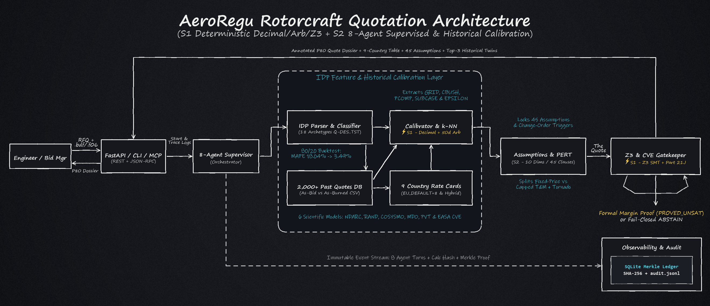

# aeroregu

This tool assists a human reviewer. It does not determine compliance.

It stores inputs, runs a named screening method, hashes the record, and records who pressed sign-off. Product agents draft and attack text. Deterministic code recomputes every number. A supervisor written in ordinary code is the only writer to the ledger. The system abstains when a check fails or agents disagree.

The load methods are project-defined screening illustrations. They are not certification methods. This repository does not claim authority acceptance, DO-330 qualification, or a tool qualification level. It does not claim certification.

## Status, 9 November 2026

`docs/benchmarks/make_bench_latest.md` was written by `make bench` on 2026-11-10, exit 0, one process, elapsed 605050 ms. The local NASA files were present, so B3 was scored. The snapshot lists dev per-case B2 lines and per-field B3 lines. An earlier run the same day took 582382 ms and 414319 ms. The 2026-11-09 run took 2436016 ms. The counts below are ESTIMATE from the current file. This is not the 12-month goal. The programme is not complete.

- S1: 100000 synthetic cases. Scored single faults 7000/7000. The seed label `20261103` does not sample the cases. The generator and the checker are the same package.
- B1: 0 expert cases. Not scored. Another engineer has to write that set. The agent does not.
- External public files, scored 9 Nov 2026 by `external-public`, are not that set. UnitSafe (Apache-2.0, SHA-256 f7ba395958f70cfb80ff3a2559f9a428dc038cac06d35bf15a71d94f4ce92a8a): 500 rows. Parsed answer-unit dimensions agreed with the published signature on 334/361. 15 unit tokens did not parse. Numeric answers scored: 0. Kind-of-quantity rows scored: 0. Dronology (MIT): the eight-heading linker hit 0 of 1063 published positive traces. JCS outhex: the UTF-8 bytes of `arrays`, `french`, `unicode`, and `weird` match the published image, and the ledger hashes those bytes. `structures` and `values` were not scored. NIST SP 811 Appendix B.8: 106 printed interval factors agree within half the last digit, 7 disagree (`bbl>L`, `Btu>J`, `kcal>J`, `lb>kg`). QuRE v1.0.1: 2187 rows, 651 defect, not scored. The weak-word token is not the defect label, and the requirement text is not copied. Detail: `docs/benchmarks/external_public_latest.md`.
- B2: the specialist chain ties the verifier at 8/8 and does not beat it. `public_headings_only` is true. An identifier that was not seen as a public heading is not linked. Clause paragraphs were not copied. A single-LLM baseline was not run (`NOT_VERIFIED`).
- B3: the local NASA PDF was scored. `ready` is false. The gold was written in the same session. It is not a held-out set.
- B4: not ready. No public series has been scored. HUMS2025 was opened on 2026-11-09, was not downloaded, and does not make B4 ready.
- Five legal rows in `docs/legal/open_items.md` are OPEN, including export control. Signed reviews: 0. The private remote is `https://github.com/AlonsoAlviraa/aeroregu`. Notes outside this folder are not in that remote.

Later code checks, after that 2436016 ms `make bench` and not a new 100000-case run: an unrecomputed integer abstains; recall 0 on a present fault fails the bench; B4 `unit_mismatch` abstains and does not convert or store samples; the temporary same-unit count of 2 is not the public B4 result. The 12-month programme is not complete. VERIFIED on 2026-11-10: GitHub Actions run 42862445978 on commit `ca4921d` completed successfully, including `make bench` on a clean checkout. That run is not a new 100000-case snapshot. VERIFIED the same day from Actions run 42865671580 on commit `3d760a1`: S1 scored 100000 cases, false alarms 0/4000 on each shift, and abstention correctness 1.000 on each shift. That log does not replace the checked-in snapshot. VERIFIED the same evening from Actions run 42895462269 on commit `6cfd436`: all four CI jobs passed on a GitHub-only checkout, including pytest on Ubuntu and Windows. That run still does not score B3 or B4 without local `/data` files.

## Layout

- `packages/kernel` is public-safe. It must not import `packages/domain`.
- `packages/domain` holds the synthetic aircraft SL-1 and public requirement identifiers. Titles were not copied from a hashed regulatory PDF, so they are `NOT_VERIFIED`.
- Phases 4–7 (criterion cards, connectors, qualification pack, extra agents) are specified in ADR-016 through ADR-020 and are not built.

## Automated Aerospace & Rotorcraft Quotation Engine

Full documentation and module map: [`docs/quotation/README.md`](docs/quotation/README.md)



- **Deterministic Calculation, Formal Verification & Materials (60 cards):** Exact `Decimal` kernels with `python-flint` / Arb interval propagation (propagating `material_lookup` temperature/thickness intervals end-to-end into final safety margins) + dual Z3/cvc5 continuous SMT checks. Note: `12` MMPDS-16 / CMH-17 materials use screening textbook reference tables (`SCREENING_TEXTBOOK_REFERENCE_NOT_LICENSED_MMPDS_DB`); metallic `ETW` carries `moisture_applicable: false` (`1.00`) while composites apply moisture knockdown (`0.78..0.85`).
- **Composite WBS DAG + 18 Archetypes + 9 Countries:** Acyclic Part 21J precedent DAG (`Q-DES-*`, `Q-STR-*` in parallel with `Q-FDT-01`, test correlation feeding `Q-DOA-02` signoff), CPM `ES/EF/LS/LF/Float`, multi-currency FX forward hedging, Halton QMC Pareto EMV bid frontier, and literature baseline ratios.
- **Deep IDP, CAE Binary & STEP B-Rep Ingestion:** Multi-level `*INCLUDE` Nastran/Abaqus parsers, HDF5 (`.h5`) and Fortran unformatted `.op2` record scanners (failing closed with `pynastran_required_for_full_op2_extraction` when binary Nastran table blocks are present without `pyNastran`), and exact polyhedral STEP AP214/AP203 analysis (failing closed with `ocp_required_for_nurbs_brep` on curved NURBS STEP entities without `OCP`).
- **Cryptographic Attestation & Enterprise Adapters:** Production Ed25519 DSSE envelopes, Merkle inclusion proofs, SQLite WAL hash chains, CycloneDX 1.5 `uv.lock` offline scanner, and CWE-1236 `.xlsx` / corporate vector-table multi-page `.pdf` exporters; HTTP Vault Transit client alongside explicitly labeled software/in-memory PKCS#11, AWS KMS, and WebAuthn step-up emulators.
- **Historical Bids, EVM & Web Cockpit v5:** Synthetic-seeded 2,160-bid corpus (`ESTIMATE` / `ASSUMPTION`), Bid-to-Actual EVM, 7-role RCPSP leveling, Interactive Hub, `#tab-quote` (`Alt+7`) Web Cockpit v5 with synced inspector dock and editable JSON inputs, plus `53` MCP tools (and compact domain profile).

## Maturity & Verification Matrix

| Subsystem | Verification Level | Current Boundary / Honest Caveat |
|---|---|---|
| Core Kernel, Decimal Engine, Arb Intervals & Z3/cvc5 | **Production Deterministic** | Verified end-to-end; `material_lookup` propagates Arb interval bounds into method outputs |
| Material Allowables (`MMPDS-16` / `CMH-17`) | **Screening Reference** | Textbook screening tables only (`data_provenance_notice`), not a licensed MMPDS/CMH-17 database |
| Ed25519 DSSE, SQLite Chain, Merkle & Signed PDF/XLSX | **Production Cryptographic** | Independently verifiable offline via `evidence_kernel verify`; corporate multi-page PDF tables |
| STEP AP203/AP214 CAD B-Rep (`cad_brep.py`) | **Exact Polyhedral + Fail-Closed NURBS** | Exact signed-volume/inertia for faceted planar B-Rep; abstains without `OCP` on NURBS surfaces |
| Nastran `.op2` / `.h5` & Abaqus `.odb` (`cae_binary.py`) | **HDF5 + Fortran OP2 Scanner** | Extracts internal `AEROH5`/structural streams & detects real OP2 tables (`GEOM1`/`OUG1`); requires `pyNastran` for full external OP2 matrices |
| PKCS#11 HSM, AWS KMS & WebAuthn Step-Up | **Emulator / Injectable Adapter** | `backend_mode: software_hsm_emulator` & `in_memory_ed25519_stepup_emulator` unless external KMS/FIDO2 RP is wired; Vault Transit uses HTTP |
| Quotation Costing, Calibration & 2,160-Bid Corpus | **ESTIMATE / Synthetic Corpus** | Strictly advisory (`This tool assists a human reviewer`); financial/bid figures carry `ESTIMATE` / `ASSUMPTION` tags |
| `EVIDENCE_PRODUCTION=1` HTTP Auth Gate | **Default-Deny Middleware** | Rejects unauthenticated calls with `401` outside explicit public allowlist |

```text
uv run python -m evidence_api.cli quote archetypes
uv run python -m evidence_api.cli quote helicopter --text "CS-29 HEMS rescue hoist STC" --country ES
uv run python -m evidence_api.cli quote composite --archetypes Q-DES-02,Q-DES-04,Q-STR-01,Q-STR-02,Q-STR-03,Q-FDT-01,Q-DOA-02,Q-TST-01 --country ES
uv run python -m evidence_api.cli quote change-order --baseline-text "CS-29 frame static" --revised-text "CS-29 frame static + F&DT + STC" --country ES
uv run python -m evidence_api.cli quote portfolio-level --rfq-count 2 --country DE --onshore DE --nearshore ES --lead-cve 1 --xlsx-out portfolio.xlsx --pdf-out portfolio.pdf
uv run python -m evidence_api.cli quote stress-dossier --dossier-id STRESS-H145-001 --xlsx-out stress.xlsx --pdf-out stress.pdf
uv run python -m evidence_api.cli quote load-envelope --envelope-id ENV-H145-CS29-001 --xlsx-out envelope.xlsx --pdf-out envelope.pdf
uv run python -m evidence_api.cli quote moc-matrix --program-id PROG-H145-MOD --xlsx-out moc.xlsx --pdf-out moc.pdf
uv run python -m evidence_api.cli quote risk-frontier --base-cost 375000 --base-price 480000 --xlsx-out risk.xlsx --pdf-out risk.pdf
uv run python -m evidence_api.cli quote fx-hedge --billing-currency USD --hedge-pct 90
uv run python -m evidence_api.cli quote evm-postmortem --project-id POST-H145 --ecn-actual 3 --xlsx-out evm.xlsx --pdf-out evm.pdf
uv run python -m evidence_api.cli quote fem-vv-audit --f06-file sol105.f06 --abaqus-file model.inp
uv run python -m evidence_api.cli quote audit-contract --text "Payment contingent on EASA approval without long-stop date"
uv run python -m evidence_api.cli quote kfold-calibrate --country ES --synthetic-count 2160 --k-folds 5
uv run python -m evidence_api.cli quote erp-template --output erp_historical_template.xlsx
```

## Commands

```text
uv sync
uv run ruff check .
uv run ruff format --check .
uv run pytest
uv run python -m evidence_eval score --split dev
uv run python -m evidence_eval external-public
uv run python -m evidence_eval score-blind-b1
uv run python -m evidence_eval score-blind-b2
uv run python -m evidence_eval score-blind-b3
uv run python -m evidence_eval hash-blind-dirs
uv run python -m evidence_eval hash-inputs PATH --at artifact.inputs
uv run python -m evidence_eval hash-file PATH
make bench
```

Set `EVIDENCE_SESSION_SECRET` to a random string of at least 24 characters, then:

```text
uv run python -m evidence_api
```

Open `http://127.0.0.1:8000`. Leave `MODEL_BASE_URL` unset. The gateway then stays on fixtures and does not call a network model.

Smoke without a model URL:

```text
uv run python infra/smoke.py
```

Verify an exported chain:

```text
uv run python -m evidence_kernel verify chain.json
```

## Local secret scan

CI runs `tools/security/secret_scan.py` and the gitleaks GitHub Action with the default `GITHUB_TOKEN`. That token is not a paid license secret. If the action cannot run, install gitleaks locally and run:

```text
gitleaks detect --source . --config .gitleaks.toml
uv run python tools/security/secret_scan.py
```

## Gate

`docs/legal/gate.md` records that the founder ordered this implementation. It is not a record that employment counsel was consulted. It is not legal advice and not a clearance.
