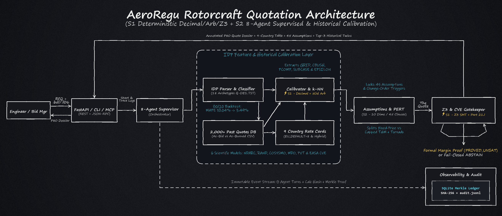

# AeroRegu — Aerospace & Rotorcraft Multi-Agent Quotation Engine



> **Advisory & Regulatory Boundary:** Every rate card, parametric effort multiplier, PERT triple, and cost estimate produced by this engine is explicitly labeled `ASSUMPTION` or `ESTIMATE`. The system assists engineering managers and independent **Part 21J Compliance Verification Engineers (CVEs)**; it **never** determines regulatory compliance or certifies airworthiness artifacts autonomously.

---

## Core Capabilities

1. **Zero LLM Math (`Decimal` + 50-Digit `FLINT/Arb` Intervals + Rotorcraft Stress & Financial Cards):**
   - `47` total deterministic calculation cards (`5` quotation costing cards + `42` aerospace & rotorcraft stress sizing cards; `8` MMPDS-16 / CMH-17 Rev H materials including `AL-LI-2198-T8`, `AS4-8552-PW`, `T800-M21-UD`; commercial outputs labeled `ASSUMPTION` / `ESTIMATE`, `not_a_certification_method: true`) compute every price, labor cost, overhead, contingency, PERT percentile (`P50 / P80 / P90`), learning curve, country inflation, monthly working-capital cash flow, and margin with zero floating-point arithmetic:
     - [`aerospace_quotation_costing.json`](../../packages/calc/cards/aerospace_quotation_costing.json)
     - [`engineering_workpackage_quote.json`](../../packages/calc/cards/engineering_workpackage_quote.json)
     - [`rotorcraft_archetype_quote.json`](../../packages/calc/cards/rotorcraft_archetype_quote.json)
     - [`rotorcraft_historical_calibration.json`](../../packages/calc/cards/rotorcraft_historical_calibration.json)
     - [`aerospace_multiyear_cashflow_learning.json`](../../packages/calc/cards/aerospace_multiyear_cashflow_learning.json) (`14` inputs, `16` outputs: Wright & Crawford unit/batch learning curves, Y1–Y5 country inflation, monthly Cash-Flow / Peak Negative CF / working-capital financing cost, and net present value)
   - Plus 10 deterministic rotorcraft & composite Stress Office cards in [`rotorcraft_stress.py`](../../packages/calc/src/evidence_calc/rotorcraft_stress.py) & [`rotorcraft_stress_ext.py`](../../packages/calc/src/evidence_calc/rotorcraft_stress_ext.py) with 50-digit FLINT/Arb intervals & Z3 SMT proofs:
     - Sprint 2: [`clt_laminate_abd_stiffness.json`](../../packages/calc/cards/clt_laminate_abd_stiffness.json), [`rotor_blade_centrifugal_bending.json`](../../packages/calc/cards/rotor_blade_centrifugal_bending.json), [`ground_resonance_coleman_screen.json`](../../packages/calc/cards/ground_resonance_coleman_screen.json), [`cs29_crashworthiness_561_562_load.json`](../../packages/calc/cards/cs29_crashworthiness_561_562_load.json), [`multirow_bolt_load_distribution.json`](../../packages/calc/cards/multirow_bolt_load_distribution.json).
     - Sprint 3: [`larc04_composite_failure.json`](../../packages/calc/cards/larc04_composite_failure.json), [`cs29_bird_strike_penetration_screen.json`](../../packages/calc/cards/cs29_bird_strike_penetration_screen.json), [`campbell_rotor_harmonic_clearance.json`](../../packages/calc/cards/campbell_rotor_harmonic_clearance.json), [`tailboom_boxbeam_combined_stress.json`](../../packages/calc/cards/tailboom_boxbeam_combined_stress.json), [`statistical_ab_basis_tolerance_bound.json`](../../packages/calc/cards/statistical_ab_basis_tolerance_bound.json).
   - Implemented in [`quotation_costing.py`](../../packages/calc/src/evidence_calc/quotation_costing.py), [`rotorcraft_stress.py`](../../packages/calc/src/evidence_calc/rotorcraft_stress.py), and [`rotorcraft_stress_ext.py`](../../packages/calc/src/evidence_calc/rotorcraft_stress_ext.py) with 50-digit unrounded ball enclosures in [`intervals.py`](../../packages/calc/src/evidence_calc/intervals.py) and full built-in shadowing protection in [`plugins.py`](../../packages/calc/src/evidence_calc/plugins.py).

2. **Composite WBS DAG (Q1) + 18 Rotorcraft Engineering Archetypes (`Q-DES-01` .. `Q-TST-02`):**
   - [`composite_dag_quotation.py`](../../packages/coverage/src/evidence_coverage/composite_dag_quotation.py) (`build_composite_wbs_dag`, `run_composite_rotorcraft_quotation`) composes `N` simultaneous archetypes (e.g. `Q-DES-02 + Q-DES-04 + Q-STR-01 + Q-STR-02 + Q-STR-03 + Q-FDT-01 + Q-DOA-02 + Q-TST-01`) into an acyclic WBS DAG (cycle-safe fail-closed `ABSTAIN`), computes deterministic Critical Path Method schedules (`ES/EF/LS/LF/Float` in weeks), and applies formal GFEM/CAD/loads engineering reuse synergy while preserving the mandatory independent CVE review floor.
   - Covers airframe concept & cabin layout, metallic detail design, CFRP ply-books, Weight & Balance, CS-27/CS-29 Subpart C loads, full-airframe GFEM & `.f06` audits, DFEM static stress dossiers, supplier stress gatekeeping, airframe F&DT, dynamic components (`MRB/MRH/MGB`), modal/`SOL 103`/ground resonance, `CS 29.561/562` crashworthiness, SPH/ALE bird-strike & ditching, MRB repairs & Service Bulletins, HEMS/Hoist/Cargo-Hook STCs, propulsion mounts/1100C firewalls/HIRF, structural test rigs, and FTI / Permit to Fly (`Part 21J Subpart P`).
   - Orchestrated across 8 supervised agent steps mapped to kernel `ACTIVE_AGENTS` in [`rotorcraft_quotation_catalog.py`](../../packages/coverage/src/evidence_coverage/rotorcraft_quotation_catalog.py) and [`quotation_multiagent.py`](../../packages/coverage/src/evidence_coverage/quotation_multiagent.py).

3. **Default EU + 8 Country Rate Profiles & 6 Scientific Costing Models:**
   - Benchmarks every quote across **`EU_DEFAULT`** and **`FR`, `DE`, `ES`, `IT`, `UK`, `US`, `PL`, `IN`** (with Y1–Y5 country-indexed inflation profiles) plus an **Onshore CVE + Nearshore Execution** hybrid model.
   - Incorporates parametric drivers from **NASA NDARC**, **RAND NAFCOM**, **USC COSYSMO**, **Curran/Scanlan/Roy Design-to-Cost MDO**, **GARTEUR HELIX/FELIX/PVT**, and **EASA AI Concept Paper / Part 21.A.239(b)** (`8%–20%` non-waivable independent CVE review floor).

4. **10-Dimension Standardized Assumptions (45 Clauses) + Z3 SMT Unit & Multi-Year Margin/NPV Gates:**
   - Locks assumptions and Change-Order triggers across `TECHNICAL_SCOPE`, `ROTORCRAFT_LOADS_SPECTRA`, `DYNAMICS_VIBRATION_AEROELASTIC`, `DOA_CERTIFICATION_PRIVILEGES`, `DATA_AND_IDP`, `SCHEDULE_AND_ITERATIONS`, `COMMERCIAL_AND_RATES`, `LEGAL_IP_AND_EXPORT`, `TOOLING_AND_COMPUTE`, and `RISK_AND_ABSTAIN_TRIGGERS`.
   - Proves formally via **Z3 SMT (`PROVED_UNSAT`)** both single-period `P80` margin (`prove_quotation_margin_envelope`) and 3-variable denominator-cleared multi-year NPV & post-financing margin (`prove_multiyear_npv_and_margin_envelope`, ~`134 ms` UNSAT / ~`29 ms` counterexample SAT); triggers fail-closed `ABSTAIN` on DAG cycles, contractual red-flags, CVE waivers, invalid margins, unsupported countries, or out-of-domain requests.

5. **Deep Physical IDP Inspector (Q2 + Sprint 3) — Multi-Include BDF/Abaqus, Binary OP2/H5, STEP B-Rep & BOM/Drawings:**
   - [`deep_idp_quotation_extractor.py`](../../packages/coverage/src/evidence_coverage/deep_idp_quotation_extractor.py) (`extract_deep_idp_engineering_package`) couples [`fem_parsers.py`](../../packages/ingest/src/evidence_ingest/fem_parsers.py), [`cae_binary.py`](../../packages/ingest/src/evidence_ingest/cae_binary.py), [`cad_brep.py`](../../packages/ingest/src/evidence_ingest/cad_brep.py), and [`bom_drawing_extractor.py`](../../packages/ingest/src/evidence_ingest/bom_drawing_extractor.py):
     - Resolves sandboxed nested Nastran `INCLUDE` and Abaqus `*INCLUDE, INPUT=...` trees (`Path.is_relative_to`), Abaqus `*SHELL SECTION, COMPOSITE` ply books, `CORD1/2` local coordinate systems, exact DOF/constraint summaries (`SPC/SPC1/RBE2/RBE3/MPC`), `PSHELL/PCOMP/PBAR/PBEAM/PSOLID/PCOMPG` property counts, structural vs. `CBUSH` element separation, and binary `.op2`/`.h5` + `.f06` (`SOL 103` modal, `SOL 105` linear buckling eigenvalues & MS, `GRID POINT FORCE BALANCE` freebody equilibrium) solve/post-processing hour sizing.
     - Computes exact B-Rep solid surface area, PCA-aligned Oriented Bounding Box (`obb_dims_mm`, `stock_bbox_volume_mm3`), geometric **Buy-to-Fly** ratio, and machining complexity index from STEP AP203/214/242 models without guesswork.
     - Extracts Bill of Materials (`BOM`) and Drawing Lists from PDF (with verified `page_no` + `bbox` coordinates), XLSX, and DOCX RFQ attachments.

6. **Clause-by-Clause Contractual Auditor, Change Orders (CCN) & Hardened OEM Exporters (Q3 + Sprint 2):**
   - [`contract_clause_auditor.py`](../../packages/coverage/src/evidence_coverage/contract_clause_auditor.py) (`audit_rfq_contract_clauses`) normalizes Unicode (`NFKC`, strips category `Cf` zero-width characters, folds Cyrillic/Greek homoglyphs), classifies technical, commercial, quality, and legal RFQ clauses into `SUPPORTED`, `PARTIALLY_SUPPORTED_WITH_ASSUMPTION`, `CHANGE_ORDER_REQUIRED`, or `REJECT_OR_ABSTAIN`, and flags 6 poison clauses: `UNCAPPED_LIQUIDATED_DAMAGES`, `UNLIMITED_FREE_REDESIGN`, `BACKGROUND_IP_ASSIGNMENT`, `OPEN_ENDED_AUTHORITY_PAYMENT_GATE`, `EXCESSIVE_WARRANTY_RETENTION`, and `CVE_INDEPENDENCE_WAIVER`.
   - [`quotation_change_order.py`](../../packages/coverage/src/evidence_coverage/quotation_change_order.py) (`compute_quotation_change_order`) compares Rev A vs. Rev B across WBS DAG nodes, CPM schedule, multi-year cash flow/NPV, IDP deltas, triggered assumptions, and Z3 SMT proofs, sealing an immutable event into the Merkle ledger.
   - [`quotation_exporter.py`](../../packages/coverage/src/evidence_coverage/quotation_exporter.py) neutralizes CWE-1236 Excel formula injection in all user-supplied text cells and generates:
     - Native 7-tab quotation & 4-tab CCN live-formula Excel workbooks (`export_quotation_xlsx`, `export_change_order_xlsx`).
     - Cryptographically signed commercial-technical & CCN PDF dossiers (`export_quotation_signed_pdf` / `export_change_order_signed_pdf` / `verify_quotation_signed_pdf`) embedding Ed25519 DSSE attestations, offline-verifiable ISO QR codes, and ledger Merkle roots.

7. **2,000+ Historical Calibration, Bid-to-Actual EVM, FX Hedging & RCPSP Leveling (Q4 + Sprints 2–3):**
   - [`historical_quotation_calibrator.py`](../../packages/coverage/src/evidence_coverage/historical_quotation_calibrator.py) provides bulk CSV/JSON/JSONL/XLSX ingestion with SHA-256 dataset hashing + reproducible `2,160`-bid benchmark corpus (`SYNTHETIC_BENCHMARK_ASSUMPTION`), Buhlmann-PERT `80/20` calibration (`18.04% -> 3.49%`), and deterministic k-NN twin retrieval.
   - [`advanced_quotation_calibration.py`](../../packages/coverage/src/evidence_coverage/advanced_quotation_calibration.py) (`run_advanced_calibration_suite`) adds IQR/MAD exogenous outlier isolation, stratified K-Fold cross-validation across archetypes/countries (`18.59% -> 3.66%` MAPE), temporal cost-drift diagnostics (`detect_calibration_drift`), `P50..P90` commercial Win-Rate calibration (`calibrate_win_rate_by_percentile`), and official ERP/SAP CSV & `.xlsx` import templates (`export_erp_sap_import_template`).
   - [`quotation_fx_hedging.py`](../../packages/coverage/src/evidence_coverage/quotation_fx_hedging.py) (`evaluate_quotation_fx_hedging`) simulates multi-currency billing/execution FX conversion (`EUR`, `USD`, `GBP`, `PLN`, `INR`), forward hedge carry costs, 5-point spot shock sensitivity, recommended minimum hedge ratio, and a continuous Z3 SMT margin-floor proof.
   - [`bid_actual_postmortem.py`](../../packages/coverage/src/evidence_coverage/bid_actual_postmortem.py) (`run_bid_actual_evm_postmortem`) closes the Bid-to-Actual ERP loop via standard EVM (`BAC`, `PV`, `EV`, `AC`, `CV`, `SV`, `CPI`, `SPI`, `EAC`, `VAC`, `TCPI`), broken `ASM-*` variance attribution, calibration record emission, and Merkle Ledger sealing.
   - [`portfolio_capacity_leveler.py`](../../packages/coverage/src/evidence_coverage/portfolio_capacity_leveler.py) (`level_portfolio_capacity`) schedules queued RFQs across 7 Stress Office roles (`LEAD_CVE`, `SENIOR_STRESS`, `STRESS_ENG`, `CAD_ENG`, `FDT_SPEC`, `TEST_ENG`, `PM_DOA`) using deterministic RCPSP priority-list leveling, quantifying bottlenecks, schedule slip weeks, nearshore overflow hours, and aggregated monthly Peak Negative Cash Flow.

8. **Global Quoting Repository Scraper, Interactive Wizard & Web Cockpit v2 (Q4 + Sprint 2):**
   - [`repo_web_scraper.py`](../../packages/coverage/src/evidence_coverage/repo_web_scraper.py) (`QuotationIntelligenceScraper`) benchmarks 32 GitHub repositories and 18 commercial quoting web platforms plus public EASA/FAA/NASA rotorcraft sources across 8 capability axes.
   - [`demo.html`](../../apps/api/src/evidence_api/static/demo.html) (`#tab-quote` / `Alt+7`), [`quotation_cockpit.js`](../../apps/api/src/evidence_api/static/quotation_cockpit.js), and [`wizard.py`](../../apps/api/src/evidence_api/wizard.py) (option `10`) provide an interactive cockpit with multi-archetype DAG & CPM SVG, monthly Cash-Flow SVG + semantic table, binary `.op2`/`.h5` & BOM uploads, Change-Order Rev A -> Rev B delta & CCN exports, RCPSP portfolio capacity view, live Z3 SMT badges, and 1-click `.xlsx`/`.pdf` download.

---

## Documentation & Research Catalogs

- [Global Multi-Agent RFQ Repositories & Web Platforms Benchmark (32 GitHub Repos, 18 Platforms)](./07-cotizaciones-multiagente-github-webs.md)
- [Helicopter Engineering Rate Cards (EU + 8 Countries), 18 Archetypes, 6 Studies, 10 Assumption Dimensions & 2,000+ Calibration](./08-catalogo-cotizaciones-supuestos-helicopteros.md)

---

## Quickstart (CLI, FastAPI, Web Cockpit & MCP)

### CLI (15 `quote` Subcommands)

```text
# List all 18 helicopter archetypes, 9 country rate profiles, and 6 research studies
uv run python -m evidence_api.cli quote archetypes

# Generate a single-archetype helicopter quotation (with optional .bdf/.f06 IDP & historical corpus)
uv run python -m evidence_api.cli quote helicopter \
  --text "CS-29 HEMS rescue hoist STC structural and F&DT justification" \
  --country ES \
  --cert-basis CS-29

# Generate a composite N-archetype WBS DAG quotation with multi-year cash flow, contract gate & OEM exports
uv run python -m evidence_api.cli quote composite \
  --archetypes Q-DES-02,Q-DES-04,Q-STR-01,Q-STR-02,Q-STR-03,Q-FDT-01,Q-DOA-02,Q-TST-01 \
  --country ES --units 3 --years 4 \
  --xlsx-out composite_quote.xlsx --pdf-out composite_quote.pdf

# Audit RFQ commercial/legal/technical clauses for poison clauses & DOA gates
uv run python -m evidence_api.cli quote audit-contract \
  --text "Payment contingent solely on EASA approval without long-stop date; Contractor waives CVE review."

# Inspect nested BDF + STEP B-Rep (Buy-to-Fly) + PDF/XLSX/DOCX BOM package
uv run python -m evidence_api.cli quote deep-idp --file model_master.bdf --file fitting.stp --file bom.pdf

# Run 80/20 backtest, stratified K-Fold CV + drift/win-rate calibration, or export ERP/SAP templates
uv run python -m evidence_api.cli quote calibrate --archetype Q-STR-03 --country ES --synthetic-count 2160
uv run python -m evidence_api.cli quote kfold-calibrate --country ES --synthetic-count 2160 --k-folds 5
uv run python -m evidence_api.cli quote erp-template --output erp_historical_template.xlsx

# Run general 8-agent RFQ quotation, 45-assumption catalog & GitHub/Web scraper benchmark
uv run python -m evidence_api.cli quote generate --text "Supply 12 Ti-6Al-4V lugs (1.5 kg) with 3 calc notes"
uv run python -m evidence_api.cli quote assumptions
uv run python -m evidence_api.cli quote scrape --offline

# Compute closed-loop Rev A -> Rev B Change-Order delta & Stress Office RCPSP portfolio leveling
uv run python -m evidence_api.cli quote change-order --baseline-text "CS-29 frame static" --revised-text "CS-29 frame static + F&DT + STC" --country ES
uv run python -m evidence_api.cli quote portfolio-level --rfq-count 2 --country ES --lead-cve 1

# Simulate multi-currency FX forward hedging (Z3 SMT margin proof) & Bid-to-Actual EVM post-mortem
uv run python -m evidence_api.cli quote fx-hedge --billing-currency USD --hedge-pct 90
uv run python -m evidence_api.cli quote evm-postmortem --project-id POST-H145 --ecn-actual 3
```

### FastAPI Endpoints ([`app.py`](../../apps/api/src/evidence_api/app.py))

- `GET /quotations/catalog` & `POST /quotations/generate` & `POST /quotations/sensitivity`
- `GET /quotations/repos-benchmark` & `POST /quotations/scrape-repos`
- `GET /quotations/rotorcraft/catalog` & `POST /quotations/rotorcraft/generate`
- `POST /quotations/rotorcraft/calibrate-historical`
- `POST /quotations/rotorcraft/composite-dag` & `POST /quotations/rotorcraft/multiyear-cashflow`
- `POST /quotations/rotorcraft/idp-deep-inspect` & `POST /quotations/rotorcraft/contract-audit`
- `POST /quotations/rotorcraft/export-xlsx` & `POST /quotations/rotorcraft/export-pdf`
- `POST /quotations/rotorcraft/advanced-calibration` & `GET /quotations/rotorcraft/erp-template`
- `POST /quotations/rotorcraft/change-order` & `POST /quotations/rotorcraft/change-order/export-xlsx` & `POST /quotations/rotorcraft/change-order/export-pdf`
- `POST /quotations/rotorcraft/portfolio-capacity`
- `POST /quotations/rotorcraft/fx-hedging` & `POST /quotations/rotorcraft/evm-postmortem`
- `GET /demo` (`#tab-quote` / `Alt+7`) & `GET /static/quotation_cockpit.js`

### MCP Tools ([`mcp_server.py`](../../apps/api/src/evidence_api/mcp_server.py) — 13 Quotation Tools / 45 Total)

- `generate_multiagent_quotation`
- `scrape_global_quotation_repos`
- `generate_rotorcraft_archetype_quotation`
- `calibrate_and_match_historical_quotations`
- `generate_composite_rotorcraft_quotation`
- `audit_rfq_contract_clauses`
- `inspect_deep_idp_package`
- `export_quotation_oem_artifacts`
- `run_advanced_quotation_calibration`
- `compute_quotation_change_order`
- `level_rotorcraft_portfolio_capacity`
- `evaluate_quotation_fx_hedging`
- `run_bid_actual_evm_postmortem`

### Test Suites

- [`test_quotation_multiagent_and_scraper.py`](../../tests/test_quotation_multiagent_and_scraper.py)
- [`test_rotorcraft_18_archetypes_and_countries.py`](../../tests/test_rotorcraft_18_archetypes_and_countries.py)
- [`test_historical_2000_calibration_idp_knn.py`](../../tests/test_historical_2000_calibration_idp_knn.py)
- [`test_year1_quotation_master_roadmap.py`](../../tests/test_year1_quotation_master_roadmap.py)
- [`test_sprint2_rotorcraft_stress_ccn_portfolio_security.py`](../../tests/test_sprint2_rotorcraft_stress_ccn_portfolio_security.py)
- [`test_sprint3_larc04_fem_fx_evm_security.py`](../../tests/test_sprint3_larc04_fem_fx_evm_security.py)
